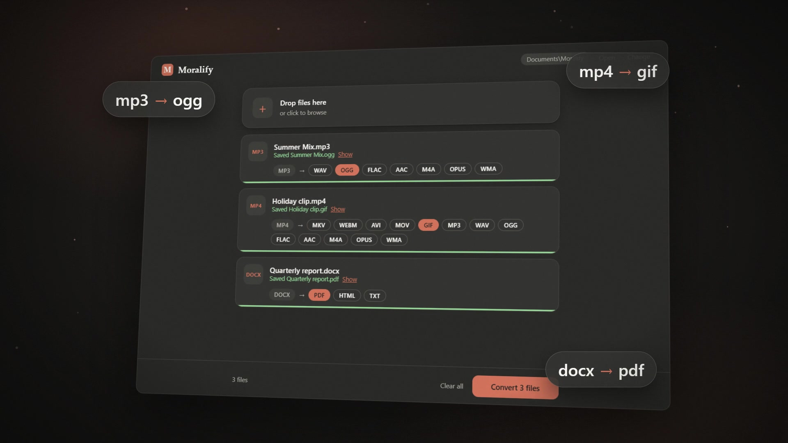
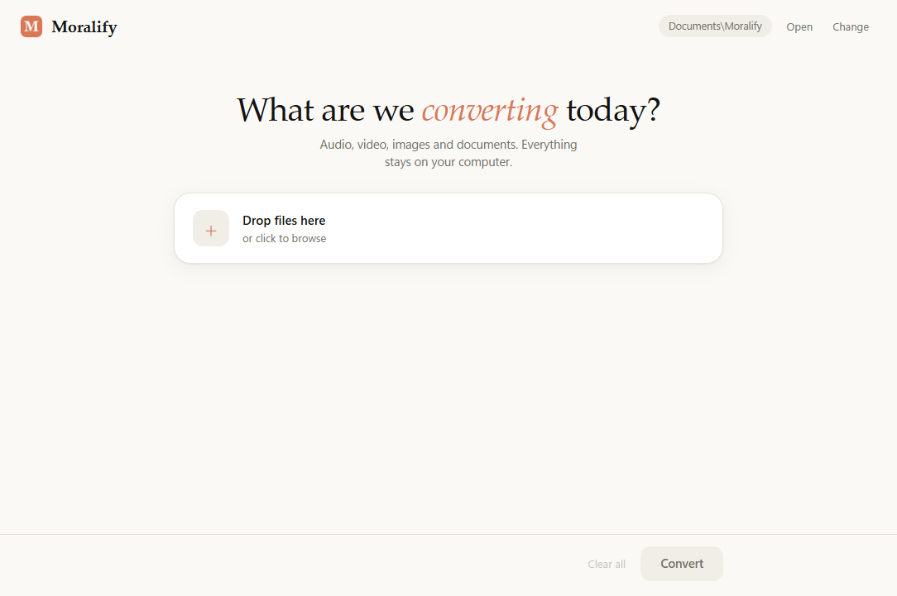
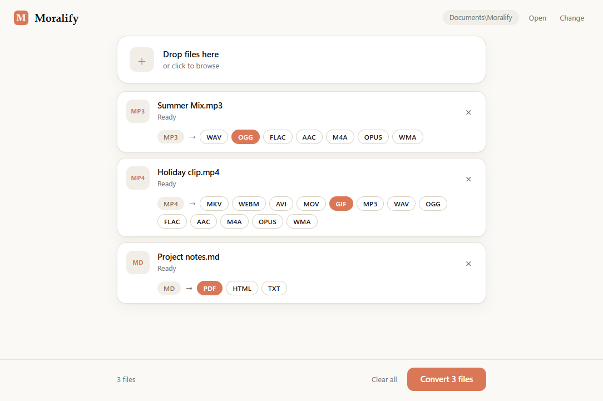
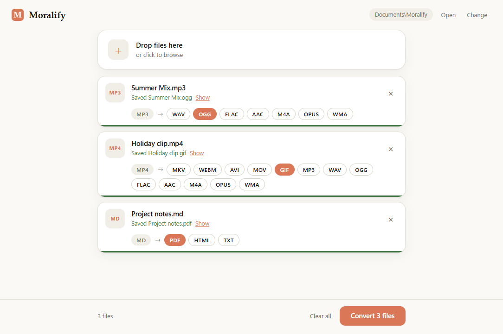
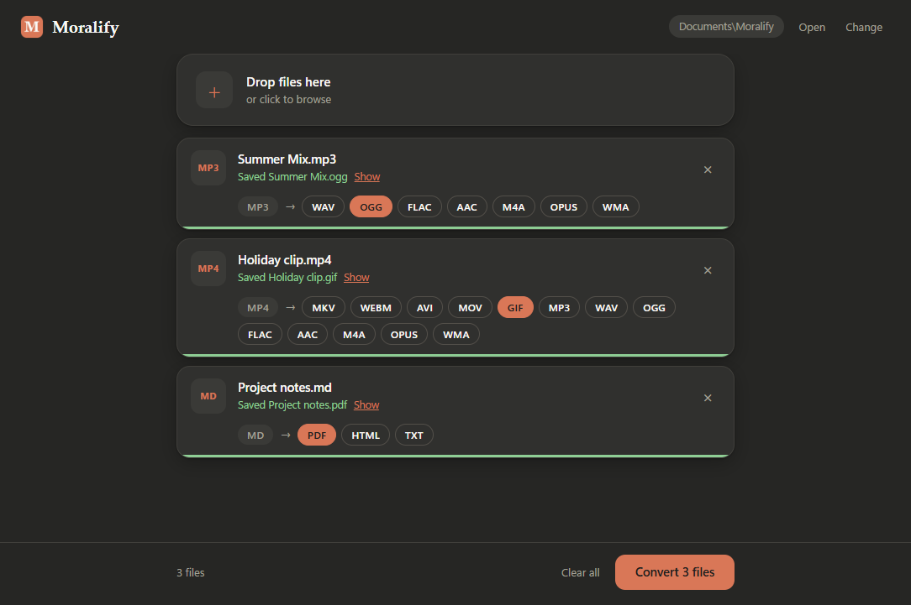

# Moralify

A free, open source Windows desktop app that converts audio, video, image and document files. Everything runs on your machine; nothing is uploaded.

[](demo/moralify-brag.mp4)

*Click the image to watch the 20-second demo.*

## Features

- Drag and drop files, or click to browse. Convert many files at once.
- Pick the output format for each file by clicking a format button (`MP3 → WAV OGG FLAC ...`).
- Batch shortcuts: **All videos → MP3** pulls the audio out of every video in the queue, and **Set all to** applies one format to every file that supports it.
- Per-file progress, with a "Show" link to the converted file.
- Converted files are saved to `Documents\Moralify` by default. Use **Open** to view the folder and **Change** to pick another one.
- Never overwrites: if a file exists, the new one is saved as `name (1).ext`.

## Screenshots







Moralify follows your Windows light or dark theme:



## Supported conversions

| Input | Output |
| --- | --- |
| Audio: mp3, wav, ogg, flac, aac, m4a, opus, wma | the other audio formats |
| Video: mp4, mkv, webm, avi, mov | other video formats, GIF, or audio only |
| Images: png, jpg, webp, bmp, gif, tiff | other image formats, PDF |
| docx | pdf, html, txt |
| md | pdf, html, txt |
| html | pdf, txt |
| txt | pdf, html |

**With [LibreOffice](https://www.libreoffice.org/) installed** (detected automatically):
doc, xls, xlsx, ppt, pptx, odt, ods, odp and rtf can be converted to PDF and other document formats, and docx can also become odt or rtf.

**Not supported yet:** PDF to other formats.

## Install

Download `Moralify Setup 1.0.0.exe` (from the Releases page, or build it yourself, see below) and run it. The setup:

1. Shows the terms and conditions, which you must accept.
2. Lets you choose the install folder.
3. On the last page, offers to launch Moralify and to create a desktop shortcut.

It installs for the current user only and needs no admin rights. The default location is `%LOCALAPPDATA%\Programs\moralify`.

The installer is not code-signed, so Windows SmartScreen may warn: click *More info*, then *Run anyway*.

### Uninstall

Settings → Apps → Installed apps → Moralify → Uninstall, or run `Uninstall Moralify.exe` from the install folder. Your converted files in `Documents\Moralify` are kept.

## Develop

Requires Node.js.

```bash
npm install
npm start        # run the app
npm run dist     # build the Windows installer into dist/
```

## Project layout

```
src/
  main.js          Electron main process: window, dialogs, IPC
  preload.js       Safe bridge between UI and main process
  converters.js    Conversion logic (ffmpeg, mammoth, marked, LibreOffice)
  renderer/        UI (index.html, style.css, renderer.js)
build/
  icon.ico         App and installer icon
  icon.png         Icon used for the app window
  installer.nsh    Custom installer finish page (desktop shortcut option)
  license.txt      Terms shown by the installer
```

## Third-party software

Moralify is built with Electron, [ffmpeg-static](https://github.com/eugeneware/ffmpeg-static) (audio, video, images), [mammoth](https://github.com/mwilliamson/mammoth.js) (docx) and [marked](https://github.com/markedjs/marked) (Markdown). PDFs for documents are rendered with Electron's built-in printing.

The bundled FFmpeg binary is distributed under the GNU GPL; see <https://ffmpeg.org/legal.html>. LibreOffice, if used, is a separate program with its own license.

The demo video's music is "Happy Beats / Business Moves vol. 9" by Sascha Ende ([ende.app](https://ende.app)), licensed CC BY 4.0.

## License

[MIT](LICENSE) © 2026 Morale

