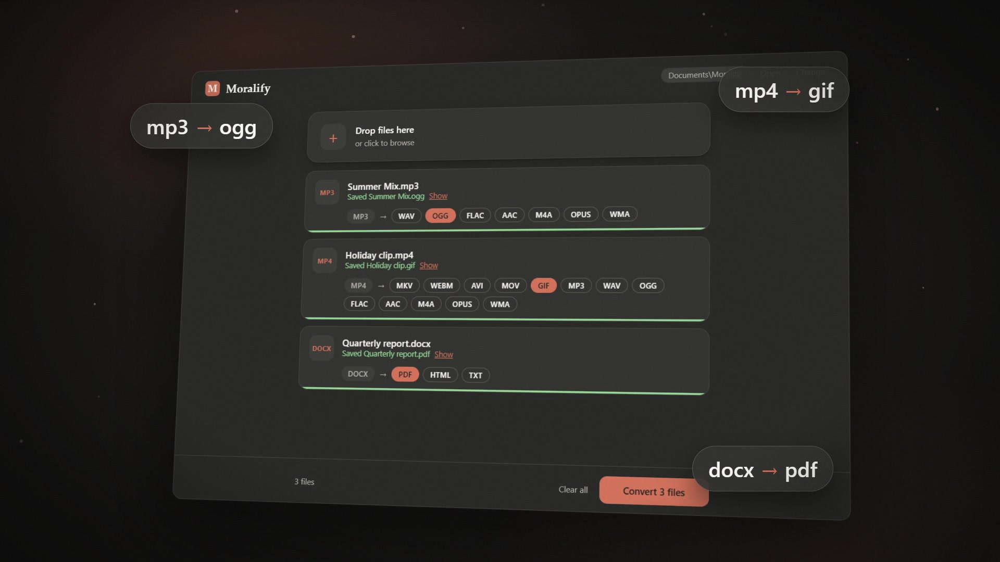
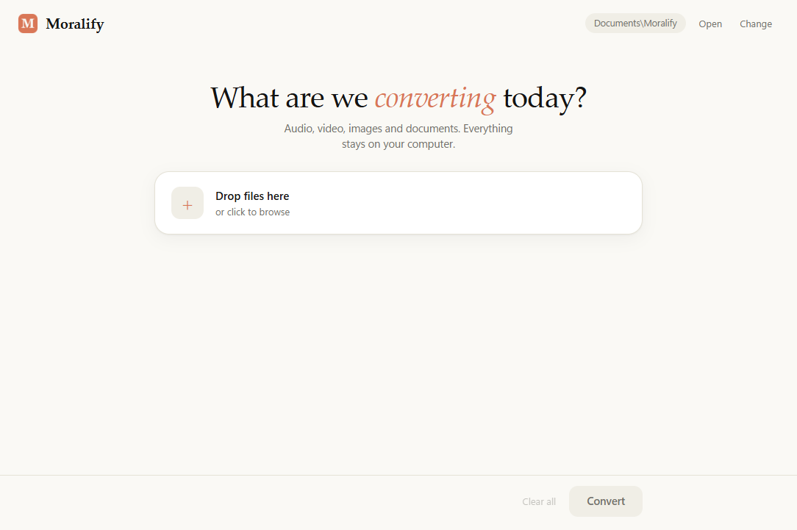
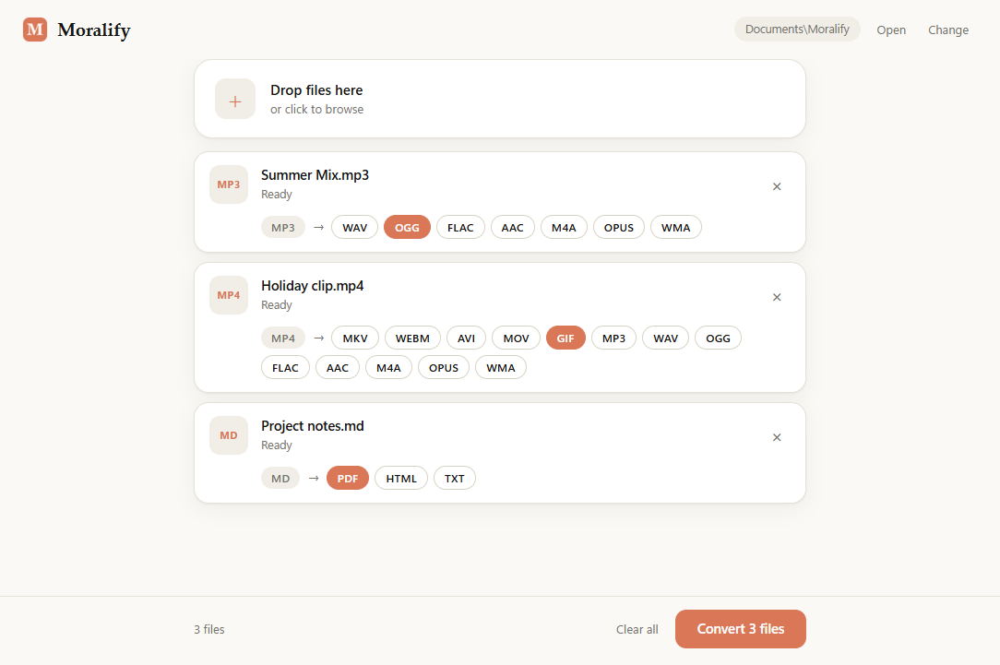
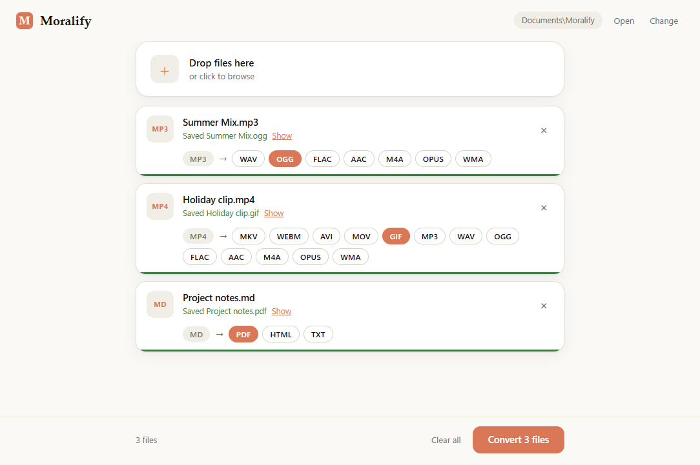
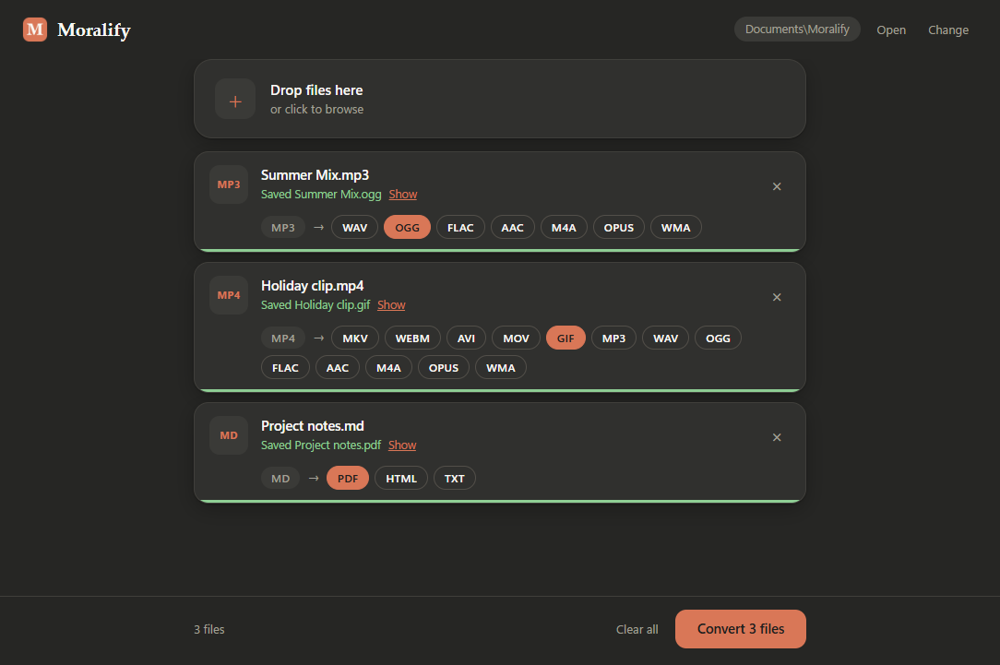

# Moralify

A free, open source Windows desktop app that converts audio, video, image and document files. Everything runs on your machine; nothing is uploaded.

[](demo/moralify-brag.mp4)

*Click the image to watch the 20-second demo.*

## Features

- Drag and drop files, or click to browse. Convert many files at once.
- **Batch convert a whole folder:** drop a folder on the window, or click **Add folder**. Pick the file types to include (for example only PNG), pick the output format (for example JPG), and Moralify converts everything in it, subfolders too. Results go to `Documents\Moralify\<folder name>` with the same subfolder layout, and files that are already in the target format are skipped.
- **Picture options:** set the JPG/WEBP quality and a maximum size (longest side, never enlarged), or use **Compress for email**. The settings apply to single files and whole folders and are remembered. Converted pictures never carry over location or camera data (except RAW to JPG with default settings, which copies the camera's own JPEG as is).
- Pick the output format for each file by clicking a format button (`MP3 → WAV OGG FLAC ...`).
- Batch shortcuts: **All videos → MP3** pulls the audio out of every video in the queue, and **Set all to** applies one format to every file that supports it.
- Per-file progress, with a "Show" link to the converted file.
- **Images to one PDF:** queue two or more pictures (any mix of PNG, JPG, HEIC, RAW, TIFF and so on) and click **N images → one PDF**. Each picture gets its own page, portrait or landscape to suit it.
- **Right-click in Explorer:** the installer adds **Convert with Moralify** to the context menu of files (every type the app supports) and folders. On Windows 11 it is under *Show more options*. It opens the file or folder in the running Moralify window.
- Remembers your output folder and the last format you picked for each file type.
- A **Stop** button cancels a running conversion (and any half-written file is removed).
- Converted files are saved to `Documents\Moralify` by default. Use **Open** to view the folder and **Change** to pick another one.
- Never overwrites: if a file exists, the new one is saved as `name (1).ext`.

## Screenshots







Moralify follows your Windows light or dark theme:



## Supported conversions

| Input | Output |
| --- | --- |
| Audio: mp3, wav, ogg, flac, aac, m4a, opus, wma | the other audio formats |
| Video: mp4, mkv, webm, avi, mov | other video formats, GIF, or audio only |
| Images: png, jpg, webp, bmp, gif, tiff | other image formats, PDF |
| iPhone photos: heic, heif | png, jpg, webp, bmp, gif, tiff, PDF |
| pdf | png, jpg, webp: one picture per page, saved in a folder named like the PDF |
| Camera RAW: cr3, cr2, nef, arw, dng, raf, orf, rw2 and similar | png, jpg, webp, bmp, gif, tiff, PDF (see the note below) |
| docx | pdf, html, txt |
| md | pdf, html, txt |
| html | pdf, txt |
| txt | pdf, html |

**With [LibreOffice](https://www.libreoffice.org/) installed** (detected automatically):
doc, xls, xlsx, ppt, pptx, odt, ods, odp and rtf can be converted to PDF and other document formats, and docx can also become odt or rtf.

**About camera RAW:** Moralify converts the full-size JPEG preview that the camera stores inside every RAW file. It looks like the camera's own JPEG, but it is not a "developed" copy of the sensor data, and its resolution can be lower than the full photo. Developing the true RAW data would need a RAW engine such as LibRaw.

**Not supported yet:** PDF to Word/text, and full-quality RAW development.

## Install

Download `Moralify Setup 1.0.0.exe` (from the Releases page, or build it yourself, see below) and run it. The setup:

1. Shows the terms and conditions, which you must accept.
2. Lets you choose the install folder.
3. On the last page, offers to launch Moralify and to create a desktop shortcut.

It installs for the current user only and needs no admin rights. The default location is `%LOCALAPPDATA%\Programs\moralify`.

The installer is not code-signed, so Windows SmartScreen may warn: click *More info*, then *Run anyway*.

### Uninstall

Settings → Apps → Installed apps → Moralify → Uninstall, or run `Uninstall Moralify.exe` from the install folder. Your converted files in `Documents\Moralify` are kept.

## Develop

Requires Node.js.

```bash
npm install
npm start        # run the app
npm run dist     # build the Windows installer into dist/
```

**Publishing a release:** push a version tag (for example `git tag v1.1.0 && git push origin v1.1.0`). The GitHub Actions workflow in `.github/workflows/release.yml` builds the installer and attaches it to a release for that tag.

## Project layout

```
src/
  main.js          Electron main process: window, dialogs, IPC
  preload.js       Safe bridge between UI and main process
  converters.js    Conversion logic (ffmpeg, mammoth, marked, LibreOffice)
  raw.js           Finds the embedded JPEG preview inside camera RAW files
  pdfrender/       Hidden window that renders PDF pages with pdf.js
  renderer/        UI (index.html, style.css, renderer.js)
build/
  icon.ico         App and installer icon
  icon.png         Icon used for the app window
  installer.nsh    Custom installer finish page (desktop shortcut option)
  license.txt      Terms shown by the installer
```

## Third-party software

Moralify is built with Electron, [ffmpeg-static](https://github.com/eugeneware/ffmpeg-static) (audio, video, images), [mammoth](https://github.com/mwilliamson/mammoth.js) (docx) and [marked](https://github.com/markedjs/marked) (Markdown). PDFs for documents are rendered with Electron's built-in printing.

The bundled FFmpeg binary is distributed under the GNU GPL; see <https://ffmpeg.org/legal.html>. LibreOffice, if used, is a separate program with its own license.

The demo video's music is "Happy Beats / Business Moves vol. 9" by Sascha Ende ([ende.app](https://ende.app)), licensed CC BY 4.0.

## License

[MIT](LICENSE) © 2026 Morale

